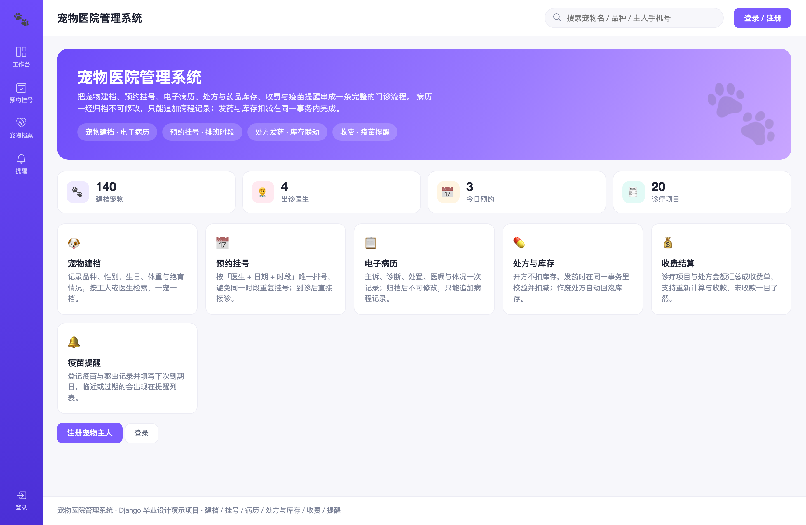
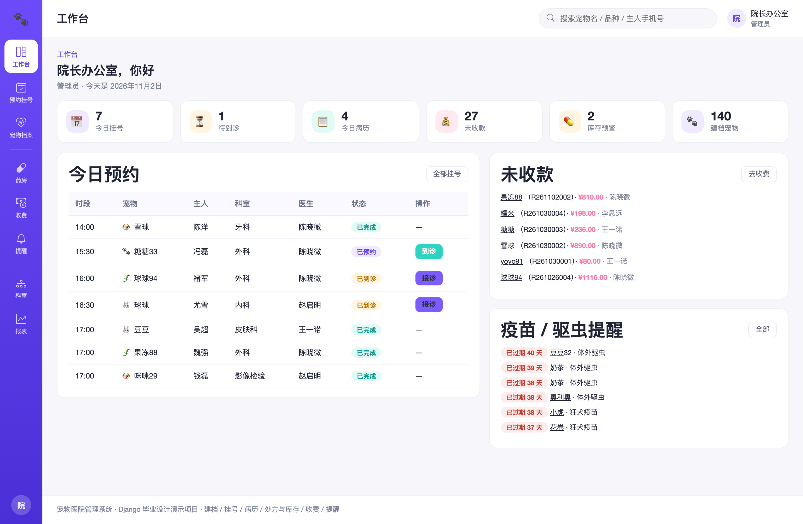
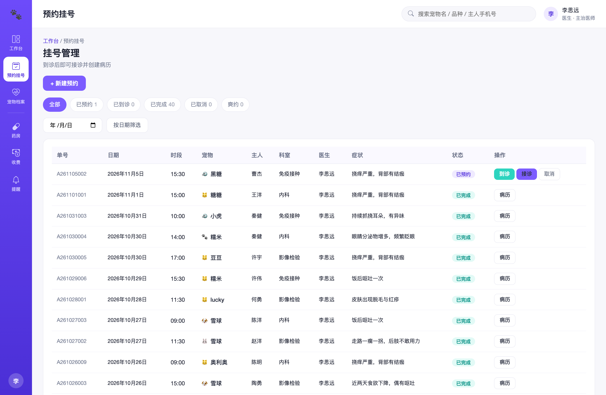
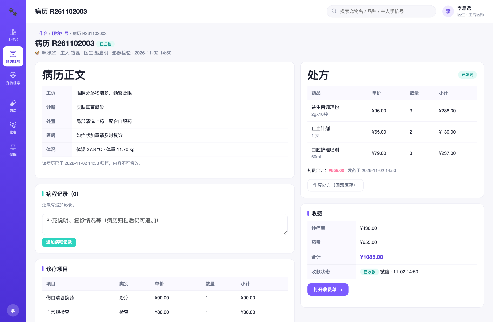
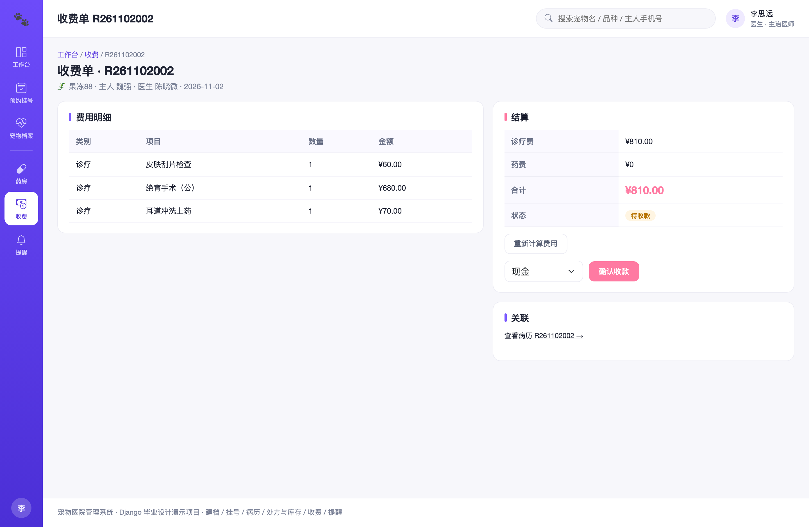
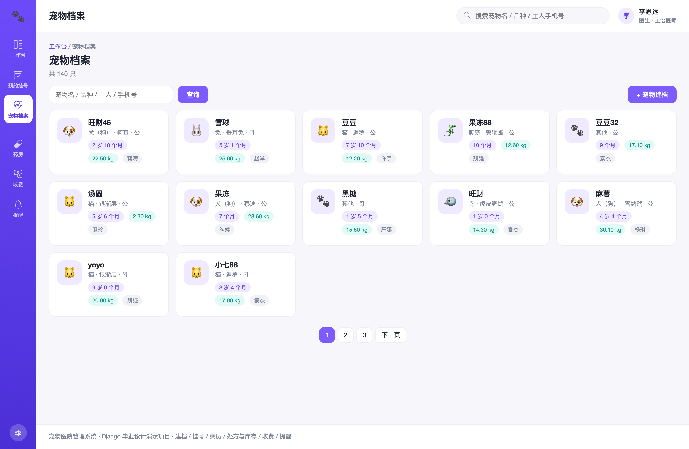
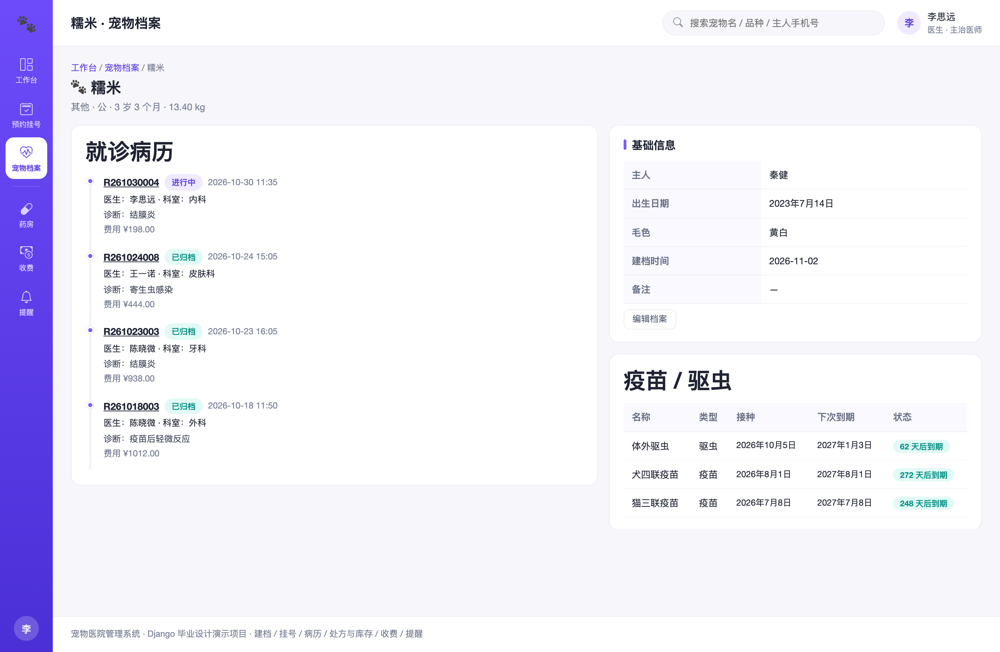
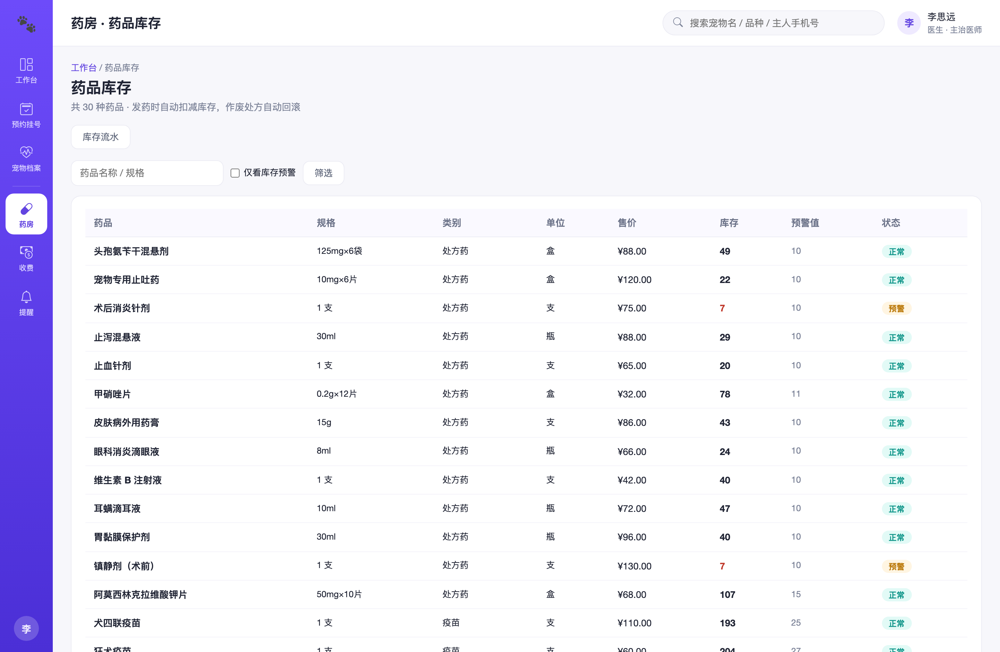
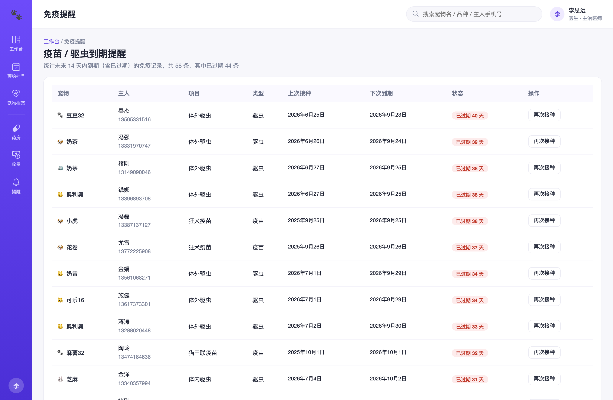
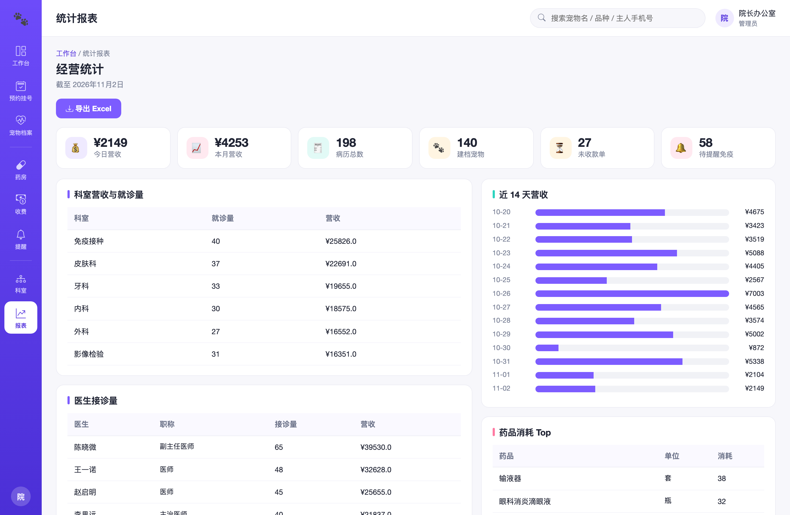

# 005 基于 Django 的宠物医院管理系统-设计展示

> **代码有偿获取 可接受定制 微信联系方式: csbysj2020 或 ACE2487，备注(BS)**

> **完整源码与全套文档 · 在线自助获取 >>> [https://mbd.pub/o/bread/YZaWlJlyaQ==](https://mbd.pub/o/bread/YZaWlJlyaQ==)**

> **成品页（功能介绍 / 更多选题）>>> [https://bishe.suilang.net/products/django-petclinic](https://bishe.suilang.net/products/django-petclinic)**

> 

> 

## 视频

> **点击查看 >>> [https://www.bilibili.com/video/BV1vT4P6MEfi/](https://www.bilibili.com/video/BV1vT4P6MEfi/)**

## 项目简介

面向中小型宠物医院的门诊管理系统：宠物建档、预约挂号、电子病历、处方与药品库存、收费结算、疫苗与驱虫提醒一站式覆盖。病历归档后不可修改只能追加病程记录；发药扣减库存、作废回滚库存，处方与库存始终一致。

随着养宠人群持续增长，宠物医疗需求快速上升，中小型宠物医院的门诊量明显增加，但管理方式仍以纸质病历与手工台账为主，存在档案分散、复诊调阅困难、挂号易冲突、处方与库存不符、疫苗漏种等问题。

本项目设计并实现了一套基于 Django 的宠物医院管理系统，采用 B/S 架构与 Django 的 MVT 模式开发，数据库使用 MySQL。

系统面向宠物主人、医生与管理员三类角色，实现了宠物建档、预约挂号、电子病历、处方与药品库存、收费结算、疫苗与驱虫提醒以及经营统计等功能。

本仓库为**设计展示**：包含项目说明、技术架构、实验结果与运行截图；完整源码、任务书、开题报告、毕业论文与使用说明可通过上方链接自助获取，成品页可查看更多选题，也可联系微信咨询定制。

## 功能特性

1. 用户与角色：宠物主人 / 医生 / 管理员，菜单与操作按角色控制

2. 宠物档案：品种、性别、生日、体重、绝育情况，按宠物/主人/手机号检索

3. 预约挂号：按科室与医生时段预约，「医生 + 日期 + 时段」唯一，避免重复约诊

4. 电子病历：主诉、诊断、处置、医嘱与体况；归档后不可修改，只能追加病程记录

5. 处方与药房：开方（待发药）→ 发药（扣减库存 + 写流水）→ 作废（回滚库存）；库存预警与采购入库

6. 收费结算：诊疗项目与处方金额汇总成收费单，支持重新计算与收款，未收款一目了然

7. 疫苗提醒：登记疫苗 / 驱虫与下次到期日，临近或过期自动进入提醒列表

8. 经营统计：营收趋势、科室与医生接诊量、药品消耗、库存与提醒，一键导出 Excel

## 技术架构

| 项目 | 说明 |
| --- | --- |
| 编程语言 | Python 3.8 及以上 |
| Web 框架 | Django 4.2 |
| 数据库 | MySQL 5.7 及以上 |
| 前端 | Bootstrap 5（已内置本地文件，离线可用，无需前端构建） |
| 报表导出 | openpyxl |
| 操作系统 | Windows / macOS / Linux |
| 启动方式 | 双击一键脚本，或 python manage.py runserver |

## 目录结构

以下为完整交付版的结构（本仓库仅作设计展示）：

```
django-petclinic/
├── 任务书/
│   └── 毕业设计任务书.docx
├── 开题报告/
│   └── 毕业设计开题报告.docx
├── 最终论文/
│   ├── 图/
│   │   ├── 图3-1_系统用例图.png
│   │   ├── 图4-1_系统架构图.png
│   │   ├── 图4-2_功能模块图.png
│   │   ├── 图4-3_就诊流程图.png
│   │   ├── 图4-4_数据库ER图.png
│   │   └── 图4-5_处方发药与库存联动流程图.png
│   └── 基于Django的宠物医院管理系统设计.docx
├── 源码/
│   ├── accounts/
│   │   ├── migrations/
│   │   ├── __init__.py
│   │   ├── admin.py
│   │   ├── apps.py
│   │   ├── decorators.py
│   │   ├── forms.py
│   │   ├── models.py
│   │   ├── urls.py
│   │   └── views.py
│   ├── clinic/
│   │   ├── management/
│   │   ├── migrations/
│   │   ├── __init__.py
│   │   ├── admin.py
│   │   ├── apps.py
│   │   ├── forms.py
│   │   ├── models.py
│   │   ├── services.py
│   │   ├── urls.py
│   │   ├── urls_home.py
│   │   └── views.py
│   ├── petclinic/
│   │   ├── asgi.py
│   │   ├── settings.py
│   │   ├── urls.py
│   │   └── wsgi.py
│   ├── pets/
│   └── …
└── …
```

## 数据与实验结论

- 用户与角色：宠物主人 / 医生 / 管理员，菜单与操作按角色控制
- 宠物档案：品种、性别、生日、体重、绝育情况，按宠物/主人/手机号检索
- 预约挂号：按科室与医生时段预约，「医生 + 日期 + 时段」唯一，避免重复约诊

## 交付内容

1. 完整源码（已跑通，含 140 只宠物 / 约 200 份病历 / 30 种药品演示数据）
2. 毕业设计任务书（Word）
3. 开题报告（Word）
4. 毕业论文（Word，七章制，含图表）
5. 系统使用与二次开发说明（Word + md）
6. 10 张系统运行截图

## 常见问题

**项目能直接跑起来吗？**

能。源码里已带数据库与演示数据，安装依赖后双击一键脚本或按说明启动即可。

**数据是怎么来的？**

本系统是院内业务系统，宠物、病历、药品等属于业务录入数据，不存在公开第三方数据源；演示数据由 seed_data 按真实业务规则程序生成（固定随机种子，可复现）。

**病历能不能改？**

病历在「进行中」阶段可以修改；点击「归档病历」后内容锁定不可修改，后续只能追加病程记录，保证可追溯。

**处方和库存怎么保证一致？**

开方只生成「待发药」不扣库存；发药时在同一事务里逐条校验并扣减库存、写库存流水；作废已发药的处方会自动回滚库存并再写一条流水。

**挂号会冲突吗？**

不会。系统对「医生 + 日期 + 时段」建立了条件唯一约束，同一医生同一时段只允许一个有效预约，冲突会直接提示。

**疫苗提醒怎么来的？**

免疫记录里保存「下次到期日」，系统按提前天数（默认 14 天）汇总即将到期与已过期的记录，方便主动通知客户。

## 截图











